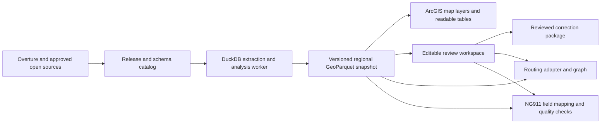

# GeoParquet add-in: code review and modernization roadmap

**Implementation update:** The review below records the original checkout and findings. Implementation now lives on `codex/cloud-native-foundation`, created from newer main `ed00783`. See [Cloud-native foundation](CLOUD_NATIVE_FOUNDATION.md) for fixes, tests, and remaining milestones; historical line references below are not current branch locations.

Reviewed 2026-09-07 at commit `a2f45da`, against the user's whole-product request. This is a review and implementation roadmap, not a shipped feature update. Production source was not changed. The checkout was initially clean.

The strongest direction is an approachable **cloud-data workspace inside ArcGIS Pro**: preserve source data, expose familiar map layers, let DuckDB perform extraction and analysis, and keep reviewed edits in a separate editable workspace. Routing and NG911 preparation can share that foundation. A display-only extract that drops provenance and routing attributes cannot support those later workflows reliably.

## Review evidence and limits

- `dotnet test DuckDBGeoparquet.Tests/DuckDBGeoparquet.Tests.csproj --nologo --verbosity minimal`: **97 passed, 0 failed, 0 skipped** on macOS, .NET 10.
- Inspected ingestion, export, map integration, cache handling, wizard/preview, geocoding, GERS matching, existing plans, and build configuration. An independent code reviewer checked matching and user workflows; separate researchers checked current primary sources.
- Executed small SQL reproductions with Python DuckDB **1.5.3**, matching the pinned engine version. These establish SQL behavior, not Windows/.NET integration behavior or end-to-end speed.
- Inspected the exact DuckDB.NET **1.5.3** provider source for async behavior. ArcGIS Pro is unavailable on this Mac: WPF responsiveness, map rendering, SDK integration, packaging, and actual network extraction were not run.
- Existing tests link dependency-free source files; they do not execute DuckDB or instantiate ArcGIS layers. Passing them does not cover the defects below.
- Supporting research: [platform capabilities](PLATFORM_RESEARCH_2026-09-07.md) and [Overture routing, contributions, and NG911](OVERTURE_ROUTING_NG911_RESEARCH_2026-09-07.md). Those documents contain detailed primary-source citations and unresolved compatibility questions.

## Standards and implementation findings

The repository's README requests existing code style and appropriate tests. No separate coding-standard breach is asserted. These are behavior and performance findings, rather than stylistic objections. P1 means fix before broadening use; P2 means a material scoped defect or inefficiency. Locations refer to the reviewed commit.

### 1. P1 — Long DuckDB operations can block the UI and prevent timely cancellation

`Views/WizardDockpaneViewModel.cs:203, 896` invokes ingestion from UI commands; `Services/DataProcessor.cs:176` awaits `ExecuteNonQueryAsync` without moving database execution off the caller thread. Preview and initialization use the same pattern. DuckDB.NET 1.5.3 overrides synchronous command execution but inherits the base async implementations, which execute synchronously. The Cancel button cannot run while the UI thread is occupied. [Pinned provider source](https://raw.githubusercontent.com/Giorgi/DuckDB.NET/1.5.3/DuckDB.NET.Data/DuckDBCommand.cs), [.NET execution contract](https://learn.microsoft.com/en-us/dotnet/api/system.data.common.dbcommand.executenonqueryasync?view=net-10.0).

**Change:** run DuckDB jobs through an owned background worker/serialized queue, leaving ArcGIS operations on its required queued thread. Register cancellation against the active command's `Cancel()` and wait for termination before resetting/disposal. Gate Load/Preview against the same operation state; moving execution to workers without isolating the shared connection and `current_table` would introduce races. Capture the target map and immutable load request before work begins.

**Verify:** a deliberately slow query leaves navigation and progress responsive; Cancel interrupts it; an immediately following job receives no stale cancellation or pending layers.

### 2. P1 — Failures and empty results can end with an unconditional success message

`Services/DataProcessor.cs:192-204` returns the same `false` for no rows and exceptions. `Services/ParquetExporter.cs:202-205` swallows individual export failures. `Views/WizardDockpaneViewModel.cs:977-987, 1020-1022` continues after failed items and announces that all themes loaded. `Services/LayerManager.cs:98` sets the added count before layer creation, including layers that may fail.

**Change:** return structured per-dataset outcomes: completed, empty, failed, cancelled, reused; include exported paths and actual added layers. Preserve actionable errors and offer Retry failed items. Completion must reconcile requested, exported, and displayed datasets. This matters especially when users may mistake missing roads or addresses for real coverage gaps.

### 3. P1 — Refresh deletes the working extract before its replacement succeeds

`Views/WizardDockpaneViewModel.cs:837-840` calls bulk replacement before downloading. That routine removes layers and deletes unlocked Parquet files. A subsequent network failure or cancellation leaves the user without the previous working dataset. Locked old files can remain in the same wildcard folders and contaminate subsequent consumers.

**Change:** stage a new immutable snapshot, validate it, switch the project manifest/layer sources only after success, then retire old owned snapshots. Preserve previous data for rollback. Reuse must compare release, area, selected fields and processing options; an existing type folder alone does not prove an extract covers the requested area.

### 4. P1 — GERS matching loses nearby candidates at the input boundary

`Views/GersifyDockpaneViewModel.cs:711-719` computes the exact input-point envelope; `Services/GersSql.cs:620-624` applies it without expansion before radius matching. One input point produces a zero-area envelope: any slightly displaced Overture point is discarded before the default 75 m distance test.

**Evidence:** DuckDB 1.5.3 rejected a candidate about **9.00 m** away using that envelope predicate. **Change:** expand the candidate envelope conservatively for the configured radius, including latitude and antimeridian handling, then apply exact distance. Test single points, boundary points, high latitudes, and dateline cases.

### 5. P1 — Batch geocoding accepts plausible coordinates without validating address identity

`Services/GeocoderEngine.cs:173-181` allows unrestricted substring matches. `Views/OvertureGeocoderDockpaneViewModel.cs:308-320` accepts the first candidate with valid coordinates; its coordinate check at `854-864` does not validate house number, locality, or ambiguity. `GeocodeBestAsync` requests one result, concealing competing candidates.

**Evidence:** `23 MAIN` matches `123 MAIN STREET` under the current predicate in DuckDB 1.5.3. **Change:** separate interactive suggestions from automatic acceptance; require structured address compatibility and retain alternatives. Export every input row with its original identity and matched/review/unmatched status, including conflicts and source/provider identity. Heuristic scores are not calibrated probabilities.

### 6. P1 — Fractional house numbers can receive the wrong GERS identity

`Services/GersSql.cs:350` extracts only leading digits and an optional letter, despite fractional address input in the UI. `12 1/2 Main St` becomes house number `12`. At matching coordinates, the current string similarity and score are **0.8866667** and **89.8**, passing default acceptance thresholds for `12 Main St` when other fields are compatible (`459-465`).

**Change:** preserve structured number, fraction, suffix and unit components through matching. Conflicting components must prevent automatic identity assignment; unsupported address forms go to review. Add executable SQL fixtures, not just assertions that SQL contains a particular fragment.

### 7. P2 — GERSify can process hidden records and collapse distinct input identities

Two separate defects require focused fixes. `Views/GersifyDockpaneViewModel.cs:669-670` searches the underlying feature class with an empty filter, ignoring the input layer's definition query. At `695-699`, blank business IDs are replaced with `count + 1`, which can collide with genuine IDs; input `[blank, "1"]` can become `["1", "1"]`. `Services/GersSql.cs:444-445` ranks by that identity, and accepted results join back on it.

**Change:** use layer-aware querying and an explicit All visible/Selected features scope. Use an independent unique internal row key, preserve business IDs, and report missing/duplicate keys before matching. Verify with an ArcGIS definition-query fixture and duplicate-ID SQL fixtures.

### 8. P2 — Ordinary apostrophes in output paths break exports

`Services/GeoParquetSql.cs:43` normalizes slashes but does not escape SQL literals. The preview export has the same issue. A folder such as `O'Brien` causes a parser error; this was reproduced on DuckDB 1.5.3.

**Change:** consistently use the existing literal-escaping helper for paths where SQL syntax requires literals, and parameters where supported. Validate/quote identifiers separately. Include user-profile and project-folder paths in regression fixtures.

### 9. P2 — Batch geocoding repeatedly scans the same Parquet datasets

`Views/OvertureGeocoderDockpaneViewModel.cs:300-308` invokes interactive search for every input and query variant. `Services/GeocoderEngine.cs:59-76, 162-181` repeatedly discovers schema, normalizes strings, and scans address/place files.

**Change:** build a reusable normalized regional search table, batch inputs, generate candidates using structured address components/spatial bounds, and refine candidates with similarity. Evaluate DuckDB full-text search for discovery, but do not use it as an address-identity validator. Keep an explicit provider-specific locator path where useful. Measure batch throughput and match quality together.

## Fit to the requested product

Existing strengths include bbox pushdown, familiar native Parquet layers, bundled extensions, style profiles, a capped preview, address/place search, locator construction, GERS candidate exports, and source tracing. Preserve those investments.

Two current design choices directly conflict with the requested future capabilities:

- **Source attributes are removed during ingest.** `Models/OvertureSchema.cs:19-36` drops provenance across themes; road exclusions include connectors, access restrictions, turn restrictions, speeds and more. Slim display projections are useful, but the canonical regional snapshot must retain the fields needed for routing, matching, updates and contributions. Nested attributes belong in inspectable structured data/related tables, even when a map table needs a flattened view.
- **AOI selection rewrites source geometry.** `Services/S3Ingester.cs:103-114` uses `ST_Intersection` by default while keeping source IDs. A line `(-2,0) → (2,0)` becomes `(-1,0) → (1,0)` in the reproduction. That changes length and the meaning of normalized source measures. Default to selecting complete intersecting features; offer clipping as a clearly identified derived output. Routing extraction additionally needs buffered areas and referenced topology/turn dependencies.

The code does not yet implement editable correction adjudication, upstream contribution publication, routing graph generation, or NG911 transformation/validation. Those are roadmap gaps, not regressions against existing shipped promises. The README's claims that original complex data is preserved and that loading is 5–15% faster should be narrowed or supported by retained reproducible benchmarks.

## Architecture that supports familiar layers and cloud-native data

Native ArcGIS Parquet layers are documented as read-only and use local caches. The product can feel familiar for selection, tables, styling and analysis without promising in-place editing of cloud Parquet. Edits should use an editable workspace and become reviewed overlays/derived publications. [Esri Parquet behavior](https://pro.arcgis.com/en/pro-app/latest/help/data/parquet/add-parquet-to-map.htm).

Use a project manifest containing source release/schema, file inventory, normalized AOI, selected profile/columns, query and adapter version, CRS, checksums, provenance/license references and validation results. Keep published GERS IDs distinct from local row IDs, generated graph-edge IDs, and authoritative NG911 identifiers. Refresh compares snapshots and surfaces conflicts with approved local changes.

Keep the runtime small: C#/WPF and the ArcGIS SDK for the desktop experience; embedded DuckDB for data work; an optional routing worker/service. Do not introduce a second DuckDB-WASM engine or require Spark/containers merely to explore a map. Retain WebView2 only where its preview adds useful capability; it should not be a mandatory step before loading data into the existing Pro map.

## Performance work, in order

These are hypotheses to benchmark, not measured speedup claims.

| Priority | Change | Why it should help / required measurement |
| --- | --- | --- |
| First | Background jobs, actual cancellation, immutable refresh | Reduces perceived hangs and removes unnecessary replacement/cleanup work; measure UI latency and cancellation time. |
| First | Cache file discovery/schema by immutable release; select intersecting STAC assets | The live Overture catalog exposes file bounds and AWS/Azure assets. `union_by_name=1` plus a broad S3 glob can require many footers even for `LIMIT 0`; bbox row-group pruning does not eliminate file discovery. Some catalog file bounds are large, so retain row-group filtering and cache the manifest rather than fetching every item on every load. Measure LIST/HEAD/GET counts and bytes. |
| First | Retain native caches and scope cleanup to owned outputs | `LayerManager.cs:592-593` disables display and feature caching; replacement clears known global Parquet cache directories. Test supported defaults on immutable snapshots and stop global cleanup during ordinary loads. Cache layers are distinct; measure first draw and repeated pans separately. |
| Next | Avoid unconditional clipping and repeated bbox/geometry-type computation | Reduces geometry work and preserves semantics. Compare complete-feature extraction with optional clipped output, holding included features constant. |
| Next | Reusable normalized search tables and batched matching | Avoid per-address scans and schema probes. Measure runtime, recall and wrong-identity rate on the same labeled cases. |
| Next | Spatially ordered exports and row-group/compression tuning | Compare Hilbert ordering with current output; test 64k/100k/256k row groups and supported codecs on points, roads and complex polygons. Include sort cost, first draw, warm queries, file size and memory. |
| Next | One bounded resource policy per job | `memory_limit='2GB'` is overwritten by its alias `max_memory='4GB'`; reproduction reports 3.7 GiB. Read back effective settings, reserve resources for Pro, use a per-job spill directory and disk budget. Count multiple open database instances in the process budget. |
| Later | Direct COPY or chunked extraction for suitable jobs; measured concurrency | Materialize once where multiple geometry outputs or QA reuse data. Benchmark direct COPY for known homogeneous jobs. DuckDB already parallelizes work; do not blindly parallelize jobs sharing a connection or exhaust network/memory with multiple engines. |

The inspected [Overture STAC catalog](https://stac.overturemaps.org/catalog.json) identified **2026-08-19.0** as latest during research. Resolve latest once, then pin that release throughout the job. [Official catalog guidance](https://docs.overturemaps.org/getting-data/cloud-sources/).

Evaluate stable DuckDB **1.5.5** with matching .NET/native/extensions and compatibility fixtures. DuckDB 1.5 already has core GEOMETRY and improved spatial capabilities; default COPY on **1.5.3** produced GeoParquet **1.0.0/WKB** in this review. Native GEOMETRY does not itself make the existing export incompatible. Make the interchange profile explicit and test it with supported Pro versions. Do not promise development-branch asynchronous remote I/O performance in a stable release. [DuckDB 1.5.5 release](https://duckdb.org/2026/07/22/announcing-duckdb-155), [DuckDB 1.5 announcement](https://duckdb.org/2026/03/09/announcing-duckdb-150).

Benchmark a neighborhood, dense city and rural county with pinned release/area/fields, cold and warm runs, identical machine/network settings, and at least three repetitions. Record median/tail time, remote bytes/requests, rows scanned/returned, peak memory/spill, export time, first layer draw, pan/selection latency and cancellation. Validate IDs/geometry/results before comparing timings. Set numeric acceptance targets after measuring this baseline.

## A simpler user experience

The primary path should be **Choose an area → Choose what to study → Add to map**. Default to the current map extent and the latest verified release, displaying its date. Offer named study areas and saved projects. Show optional previews and estimated size with uncertainty; a capped sample is not a count or coverage guarantee.

Offer task-oriented presets such as Buildings and places, Roads and access, and Addresses. Routing and NG911 preparation become separate guided tools once their prerequisites exist. Keep compression, storage paths, SQL, MFC creation and cache diagnostics under advanced settings/tools. MFC should not be a required concept for a first-time user.

After loading, provide a compact dataset panel: what was loaded, source date, geographic coverage, local availability, failures, and next actions. Feature inspection shows readable names, full nested properties on demand, source/GERS identity, and “Suggest a correction.” Useful no-SQL analysis includes filter, summarize within an area, compare releases, identify missing coverage, and export selected data.

Use one job state for Load/Preview/Cancel and honest per-dataset outcomes. On refresh, explain added/changed/removed features and local-edit conflicts before adoption. Prefer actionable text over a scrolling SQL/S3 log. Check keyboard-only operation, screen-reader labels, high contrast, dark theme, narrow dockpane widths, empty data, offline use and proxy-restricted environments on Windows.

## Routing, contribution and NG911 tools to build

**Routing:** pilot Overture's existing **OMF-Bifrost → Valhalla** path before building a separate engine. Overture also publishes an experimental transportation splitter. Shared connector IDs, including internal connectors, establish topology; visual crossings or `level` do not. Retain turn paths and conditional/directional access, and use the documented geodesic measure convention. Test bridges, internal intersections, via restrictions, one-way roads, access constraints, missing speeds and AOI boundaries. Expose unsupported semantics. Offer a separate Network Analyst export for licensed users after proving topology/turn translation. [OMF-Bifrost](https://github.com/OvertureMaps/transportation-routing/tree/main/omf-bifrost), [topology guide](https://docs.overturemaps.org/guides/transportation/segments-and-connectors/).

**Contributions:** create a local review workspace with original/proposed geometry and fields, evidence, source release, GERS/source IDs, contributor and reuse rights. Generate an issue/contribution package after review. Overture documents issue and organizational contribution channels; this review did not find a general transactional “save edits to Overture” API. Track proposed, reviewed, submitted and incorporated-in-release separately. Later add upstream source routing using bridge files. Do not submit anything externally as part of this review. [Overture support](https://docs.overturemaps.org/support/).

**NG911 foundation:** implement a versioned target profile using **NENA-STA-006.3-2026**, plus the receiving jurisdiction/provider's adopted requirements. Start with authoritative local centerlines, site/structure address points, PSAP/emergency-service boundaries and provisioning boundary; use Overture and, where appropriate, USDOT's National Address Database to identify candidates and gaps. Overture can supply context and possible matches, but it cannot supply authority by inference. Administrative divisions are not emergency-service boundaries; footprint centroids are not verified entrances; observed nearby addresses do not establish authoritative sided ranges. Travel routing and emergency-call routing are different functions. [NENA model](https://cdn.ymaws.com/www.nena.org/resource/resmgr/standards/nena-sta-006.3_ng9-1-1_gis_d.pdf), [NAD limitations](https://www.transportation.gov/mission/open/gis/national-address-database/national-address-database-nad-disclaimer).

Deliver a gap/work queue, field-level lineage, schema/domain checks, duplicate and address/road checks, connectivity issues, boundary conflicts and unresolved evidence. Export a **foundation for authority review**, with adoption/field verification and receiving-system acceptance recorded separately. Passing automated checks is not evidence of dispatch readiness.

**Extensions:** begin with a documented local enrichment schema linked by release/GERS and authoritative IDs: entrances/access points, address-to-entrance-to-road relations, reviewed restrictions, effective dates and verification evidence. Propose reusable public concepts upstream with a pilot agency. Do not name a local schema an official Overture NG911 extension. Preserve source-specific licensing and attribution; public basemap corrections and agency operational evidence can have different sharing requirements. [GERS](https://docs.overturemaps.org/gers/), [Overture licensing](https://docs.overturemaps.org/attribution/).

## Delivery sequence and completion gates

| Milestone | Concrete deliverable | Gate before expanding scope |
| --- | --- | --- |
| 1. Trustworthy loader | Fix findings 1–8; real DuckDB fixtures; staged snapshots; source-preserving extraction; accurate outcomes | Failed/cancelled refresh preserves the last working dataset; wrong-identity examples are rejected; UI remains responsive on Windows. |
| 2. Everyday exploration | Three-step load flow, dataset panel, readable attributes, no-SQL analysis, measured cache/discovery improvements | New users complete a study without knowing SQL/MFC; benchmarked speed and memory improve without changed analytical results. |
| 3. Stewardship | Editable overlays, match adjudication, provenance inspection, correction drafts and release conflict review | A reviewer can reproduce each proposed change and preserve accepted local edits across refreshes. |
| 4. Routing pilot | Bounded regional OMF-Bifrost/Valhalla package, routes/isochrones as Pro layers, optional native-network adapter | Restriction/topology fixtures pass; unsupported cases are visible; packaging, offline behavior and rollback work. |
| 5. NG911 preparation pilot | Jurisdiction-specific profile, field crosswalk, candidate layers, quality queue and export package | A participating GIS/911 authority reviews inferred values, missing sources and receiving-system requirements. Operational approval remains its own process. |

The first implementation slice should combine a cancellable DuckDB worker, structured load outcomes, and staged source-preserving snapshots. Those changes improve everyday use immediately and establish the data integrity needed by every later capability. A pilot jurisdiction and its adopted requirements are needed before NG911-specific mapping can be finalized; they do not block the loader and exploration improvements.
